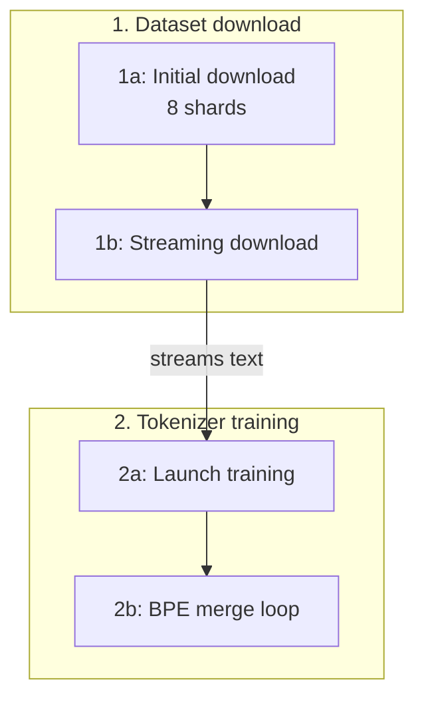

# Codemap

Recreates Windsurf's Codemaps: a map built for one question ("trace the data pipeline", "how does auth reach the DB"). It shows the reader the path through the code and the exact lines that matter, so they understand it themselves instead of taking an answer on trust. Unlike the `deepwiki` skill's standing pages, a codemap is a snapshot for one task.

## Steps

1. **Pin the question.** Turn the request into a title. If its start or end point is ambiguous, ask; if you can't, pick one and say which in the header. Record the commit (`git rev-parse --short HEAD`) and list any uncommitted files you cite in the header.
2. **Trace.** Find the entry points and follow the calls and data across files, layers and processes until the question is answered. Where a stage is pluggable, trace the implementation that runs in production and name the others. Read every line you will cite. Done when you can tell the story end to end without a gap you'd have to guess at.
3. **Cut it into traces.** A trace is one stage or path of the flow, numbered in flow order: 3 to 7 traces, each with 3 to 6 located nodes (`1a`, `1b`, ...). Past that, split it into two codemaps. A located node is the one line that carries a step: the call, the assignment, the branch, the publish. For a statement spanning lines, cite the line holding the key expression. Between located nodes, unlocated headings (function names or plain phrases) and children narrate the nesting ("Training data generator loop", "Add special tokens").
4. **Write the codemap** in the format below.
5. **Check it:** `python3 <this skill's folder>/scripts/check_codemap.py <codemap.md>`. It confirms each snippet is on its cited line, every `[1a]` ref and map node matches a located node, every node is on the map, and, when `mmdc` is installed, that the Mermaid parses. Fix until it reports 0 problems.
6. **Save it** at the user's path if they gave one, else where the repo keeps such notes. With an LLM wiki, use `<wiki>/codemaps/<slug>.md` and follow the wiki's schema for front matter, index and log; otherwise use `scratch/codemap-<slug>.md`. Report the path.

## Format

````markdown
# <Title>

<Commit and date>. Question: "<the user's request>"

<Summary: 2 to 4 sentences naming the stages, each with its key node refs, e.g. "tokenizer training [2b]".>



## 1. <Trace title>

<One line: what this trace covers.>

<details><summary>Trace guide</summary>

**Motivation.** <Why this stage exists and what problem it solves.>

**Details.** <How it works, walking the nodes in order with refs [1a], [1b].>

</details>

- <Unlocated heading: the scope these nodes run in>
  - **1a** [mid_train.py:91](<relative path>#L91) Create TaskMixture for training
    `train_dataset = TaskMixture([`
    - Load individual tasks
      - SmolTalk conversations
  - **1b** [common.py:72](<relative path>#L72) Shuffle task examples
    `rng.shuffle(self.index_map)`
````

Rules:

- **Snippets are verbatim.** Copy the cited line exactly, leading whitespace aside. Shorten only by cutting the end and marking it with `…`. Use double backticks if the line contains a backtick.
- **Links** go from the codemap file to the source, relative, with `#L<line>`. The link text is the file name and line.
- **Map.** One subgraph per trace and one node per located node, with ids `n1a`, `n1b` and labels starting `1a:`. Draw the flow, branches included, and label edges that cross traces with what passes between them. Quote every label.
- **Refs** like `[2b]` appear in the summary and guides only, and each one names a located node.
- **Trace guides** run 80 to 200 words each and explain why, not just what.

## Using a codemap

When the user points to a codemap, or one of its traces, as context for a task, read it first and start from its nodes. If `check_codemap.py` reports moved snippets, the code changed since the map was made: update the nodes before relying on them. `--list` prints every node as `path:line: [1a] title`, which a terminal makes clickable.
